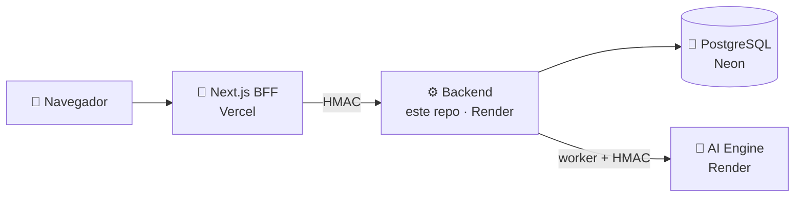
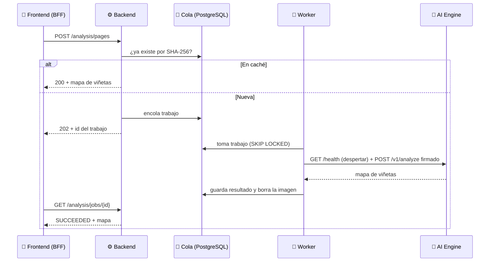

# ⚙️ PanelVault · Backend

> **API REST de PanelVault**, el gestor de cómics digitales offline-first con análisis visual inteligente. Es **el corazón del sistema**: identidad y seguridad, biblioteca y progreso de lectura de cada usuario, catálogo público de cómics libres y la **cola de análisis** que conecta con el motor de IA que detecta las viñetas y su orden de lectura.


| | |
|---|---|
| 👨‍💻 **Desarrollado por** | David Fernando Ramírez de la Parra |
| 👨‍🏫 **Profesor** | Jhonatan Andrés Mideros Narváez |
| 📚 **Asignatura** | Programación Orientada a la Web |
| 🏛️ **Institución** | Universidad Cooperativa de Colombia |

---

## 📑 Contenido

1. [El caso de estudio](#-el-caso-de-estudio)
2. [Stack](#-stack)
3. [Arquitectura de 7 capas](#-arquitectura-de-7-capas)
4. [Arquitectura hexagonal por módulo](#-arquitectura-hexagonal-por-módulo)
5. [Cumplimiento del caso de estudio](#-cumplimiento-del-caso-de-estudio)
6. [Seguridad](#-seguridad)
7. [Cola de análisis (capa asíncrona)](#-cola-de-análisis-capa-asíncrona)
8. [Sincronización offline-first](#-sincronización-offline-first)
9. [API](#-api)
10. [Ejecutar en local](#-ejecutar-en-local)
11. [Variables de entorno](#-variables-de-entorno)
12. [Pruebas](#-pruebas)
13. [Docker y despliegue](#-docker-y-despliegue)

---

## 📖 El caso de estudio

**Caso de estudio 1: Gestor de Cómics Digitales Offline-First con Análisis Visual Inteligente.**

Una plataforma web de alto rendimiento para **leer, organizar y gestionar cómics digitales** y novelas gráficas. El usuario carga sus colecciones, las lee con fluidez **con o sin conexión**, y una IA de visión por computador en el servidor convierte cada página en una **lectura guiada viñeta por viñeta**.

PanelVault está dividido en **tres repositorios independientes**:

| Repositorio | Rol |
|---|---|
| 🎨 [`panelvault-frontend`](https://github.com/dramirezdlp99/panelvault-frontend) | Interfaz web (Next.js), offline-first |
| ⚙️ **`panelvault-backend`** (este) | API, seguridad, cola de análisis y datos |
| 🧠 [`panelvault-ai-engine`](https://github.com/dramirezdlp99/panelvault-ai-engine) | Visión por computador (Python + OpenCV) |

> 🏦 **Por qué el backend es el corazón:** el frontend se considera "regalado a un atacante". Toda la lógica de negocio, los permisos y la seguridad viven aquí. Si el backend cae, la aplicación no tiene dueño; por eso nada se confía al navegador.

---

## 🧰 Stack

| | Tecnología | Para qué |
|---|---|---|
| ☕ | **Java 21** | Lenguaje: records, tipos sellados, *pattern matching* |
| 🍃 | **Spring Boot 4.1** (MVC, Security, Data JPA) | API REST, seguridad y persistencia |
| 🐘 | **PostgreSQL 17** | Base de datos (Neon en producción) |
| 🛫 | **Flyway** | Migraciones versionadas; Hibernate solo **valida** el esquema |
| 🔑 | **Nimbus JOSE + JWT** | Tokens de acceso firmados (HS256) |
| 🧪 | **JUnit 5, AssertJ, MockMvc** | Pruebas de dominio, adaptadores y punta a punta |
| 🐳 | **Docker** | Imagen liviana, sin root, para Render |

---

## 🧅 Arquitectura de 7 capas

| Capa | Dónde está en PanelVault |
|---|---|
| 1️⃣ **Cliente** | `panelvault-frontend`: Next.js, service worker, IndexedDB. Sin secretos ni reglas de negocio |
| 2️⃣ **Borde / API Gateway** | El servidor de Next.js (BFF) **firma con HMAC** cada petición; el módulo `edge` de este backend **rechaza todo lo que no venga firmado** |
| 3️⃣ **Aplicación** | **Este backend**: API REST, entidades, reglas, configuración por variables de entorno |
| 4️⃣ **Asíncrona** | Cola `analysis_jobs` en PostgreSQL y su **worker programado**, separado de las peticiones |
| 5️⃣ **IA** | `panelvault-ai-engine`, por debajo del gateway, llamado por HTTP firmado con HMAC |
| 6️⃣ **Datos** | PostgreSQL. Los archivos de los cómics **nunca llegan al servidor**: solo sus metadatos |
| 7️⃣ **DevOps** | Docker, Render, Vercel, Neon y variables por entorno |



---

## 🧩 Arquitectura hexagonal por módulo

```
com.panelvault.backend
├── shared      🧰 Errores uniformes, paginación, criptografía (Base32, TOTP), reloj
├── edge        🛡️ Capa de borde: firma HMAC del gateway y CORS
├── identity    🔐 Registro, login, JWT, refresh rotativo, 2FA, límite de intentos, roles
├── library     📚 Biblioteca de cómics de cada usuario (solo metadatos)
├── reading     🔖 Progreso de lectura y marcadores sincronizados entre dispositivos
├── analysis    🧠 Cola de análisis de viñetas y caché de resultados
└── catalog     🗂️ Catálogo público de cómics libres y su curaduría
```

Cada módulo separa sus capas (puertos y adaptadores):

| Capa | Contiene | Depende de |
|---|---|---|
| `domain` | Entidades, objetos de valor, reglas y **puertos** (interfaces) | Nada: ni Spring ni JPA |
| `application` | Casos de uso que orquestan el dominio | `domain` |
| `infrastructure` | Adaptadores: JPA, cliente HTTP del motor, JWT, cifrado | `domain`, `application` |
| `web` | Controladores REST y DTO de entrada y salida | `application` |

**Patrones de diseño:** Repository, Adapter, Factory Method, Value Object, Specification (política de contraseñas), Command, Strategy (puertos intercambiables), Decorator (petición con cuerpo cacheado), tipos sellados para resultados, y Test Fixture y Fake en las pruebas.

> 🧱 Con esta separación el dominio no sabe que existe Spring: se prueba en milisegundos con repositorios en memoria, y cambiar la base de datos o el motor de IA solo toca un adaptador.

---

## ✅ Cumplimiento del caso de estudio

| Requisito | Estado | Cómo lo resuelve el backend |
|---|---|---|
| IA de visión por computador **en el servidor** | ✅ | Cola de análisis + cliente firmado hacia `panelvault-ai-engine` |
| El servidor analiza la página al cargarla | ✅ | `POST /analysis/pages`: `202` en cola o `200` si ya estaba en caché |
| Mapa de coordenadas con la secuencia de lectura | ✅ | Se guarda por huella SHA-256 y se sirve en `GET /analysis/results/{sha256}` |
| Lectura guiada (consume el mapa) | ✅ | El frontend lo pide al abrir cada página en modo "viñeta por viñeta" |
| Offline-first: sincronizar al recuperar la red | ✅ | Escrituras **idempotentes** con ids del cliente y *last-writer-wins* |
| Progreso y marcadores sincronizados | ✅ | Módulo `reading`, compartido entre dispositivos |
| Seguridad, roles y datos protegidos | ✅ | Gateway HMAC, JWT, 2FA, RBAC y solo metadatos en el servidor |

---

## 🔐 Seguridad

- 🔒 **Contraseñas con BCrypt** (factor 12) y política de longitud, letras y dígitos. Se rechazan las de más de 72 bytes, porque BCrypt truncaría el resto en silencio.
- 🎟️ **Access token JWT de 15 minutos** y **refresh token opaco de 7 días**. Del refresh token solo se guarda su SHA-256.
- 🔄 **Rotación con detección de reúso:** si un refresh token ya usado reaparece, se revoca toda su familia de sesión. La revocación se conserva aunque la petición falle (`noRollbackFor`).
- 🕵️ **Login sin enumeración de cuentas:** el mismo error y el mismo tiempo de respuesta (hash de relleno), exista o no la cuenta.
- 📱 **2FA TOTP** (RFC 6238 implementado a mano y verificado con los vectores oficiales):
  - Secreto cifrado con **AES-256-GCM**, ligado al usuario.
  - 10 **códigos de recuperación** guardados como huella HMAC.
  - Protección contra la repetición de un mismo código.
  - Ticket del segundo paso firmado con una clave distinta a la de los access tokens.
- 🚦 **Límite de intentos** con ventana deslizante: 5 fallos en 15 minutos → `429` con `Retry-After`.
- 👥 **RBAC con jerarquía `ADMIN > CURADOR > LECTOR`**, validado siempre en el backend. El primer ADMIN se asigna en la base de datos, nunca desde la app.
- 🛡️ **Gateway HMAC:** en producción solo se aceptan peticiones firmadas por el servidor de Next.js. Una petición directa al backend recibe `401`.
- 🧾 **Errores uniformes:** el mismo JSON en toda la API, sin trazas internas (los `500` llevan una referencia para el log).
- 🔑 **Ningún secreto en el código:** todo por variables de entorno, con claves distintas para local y producción.

---

## ⏳ Cola de análisis (capa asíncrona)

La API **nunca espera a la IA**: encola la página y responde de inmediato.



- 🔐 **`SELECT … FOR UPDATE SKIP LOCKED`:** varios workers trabajan en paralelo sin tomar el mismo trabajo.
- 🎫 **Leases con token de cerca:** si un worker muere, el trabajo se retoma; si uno lento responde tarde, su resultado se descarta.
- 🔁 **Reintentos con espera exponencial y *jitter***, distinguiendo fallos temporales de definitivos.
- 🧬 **Caché por SHA-256:** la misma página se analiza una sola vez para todos los usuarios.
- 🗑️ **Las imágenes se borran al terminar:** el servidor solo conserva el mapa de viñetas.
- ⏰ **Despertar al motor:** antes de cada lote se llama a `/health`, porque el plan gratuito de Render duerme los servicios sin uso.

---

## 📴 Sincronización offline-first

- 🆔 Los ids de cómics y marcadores **los genera el cliente**, y las escrituras (`PUT`) son **idempotentes**: reintentar al recuperar la conexión nunca duplica.
- ⚖️ El progreso resuelve conflictos entre dispositivos con ***last-writer-wins***, desempate determinista por dispositivo y límite para relojes adelantados.
- 🗑️ Un borrado repetido responde `404`, y la bandeja de salida del cliente lo toma como éxito: reintentar un borrado nunca deja la cola atascada.

---

## 🌐 API

Todas las rutas cuelgan de `/api/v1`. Salvo las públicas, requieren `Authorization: Bearer <token>` (el BFF lo agrega; el navegador nunca ve el token).

| Método | Ruta | Acceso | Descripción |
|---|---|---|---|
| `POST` | `/auth/register` | 🌍 Público | Crear cuenta |
| `POST` | `/auth/login` | 🌍 Público | Login; puede pedir el segundo paso (2FA) |
| `POST` | `/auth/2fa/verify` | 🎫 Ticket | Segundo paso del login |
| `POST` | `/auth/refresh` | 🔄 Refresh token | Rotar tokens |
| `POST` | `/auth/logout` | 🔄 Refresh token | Cerrar la sesión |
| `GET` | `/me` | 👤 Lector | Perfil del usuario |
| `GET · POST` | `/me/2fa`, `/me/2fa/setup`, `/me/2fa/confirm`, `/me/2fa/disable` | 👤 Lector | Gestionar la 2FA |
| `PATCH` | `/admin/users/{id}/role` | 👑 Admin | Cambiar el rol de un usuario |
| `PUT · GET · DELETE` | `/library/comics/{id}` | 👤 Lector | Guardar (idempotente), ver y borrar un cómic |
| `GET` | `/library/comics?q=&page=&size=` | 👤 Lector | Listar y buscar la biblioteca |
| `GET` | `/library/stats` | 👤 Lector | Resumen de la biblioteca |
| `PUT · GET` | `/reading/comics/{id}/progress` | 👤 Lector | Sincronizar y leer el progreso |
| `GET` | `/reading/recent` | 👤 Lector | Continuar leyendo |
| `PUT · GET` | `/reading/comics/{id}/bookmarks[/{bookmarkId}]` | 👤 Lector | Marcadores |
| `DELETE` | `/reading/bookmarks/{bookmarkId}` | 👤 Lector | Borrar un marcador |
| `POST` | `/analysis/pages?preset=western\|manga` | 👤 Lector | Subir una página (`200` en caché, `202` en cola) |
| `GET` | `/analysis/jobs/{id}` | 👤 Lector | Estado del análisis |
| `GET` | `/analysis/results/{sha256}?preset=` | 👤 Lector | Mapa de viñetas por huella |
| `GET` | `/catalog/works`, `/catalog/works/{slug}`, `/catalog/slugs` | 🌍 Público | Catálogo de cómics libres |
| `GET · POST · PUT · DELETE` | `/curation/works[/{id}][/publish\|/unpublish]` | 🗂️ Curador | Administrar el catálogo |
| `GET` | `/actuator/health` | 🌍 Público | Salud del servicio |

**Formato de error** (igual en toda la API):

```json
{
  "status": 409,
  "code": "user.email_taken",
  "message": "Ya existe una cuenta con ese correo",
  "path": "/api/v1/auth/register",
  "timestamp": "2026-10-03T15:00:00Z"
}
```

---

## 💻 Ejecutar en local

**Requisitos:**

- ☕ JDK 21
- 🐘 PostgreSQL 17 con las bases `panelvault_dev` y `panelvault_test` (dueño: rol `panelvault`)
- 🧠 Opcional: el motor de IA en `http://localhost:8001` para analizar páginas

**Comandos (PowerShell):**

```powershell
.\mvnw test             # todas las pruebas (usan la base panelvault_test)
.\mvnw spring-boot:run  # arranca en http://localhost:9096
```

> ℹ️ Se usa el puerto **9096** porque el 8080 suele estar ocupado (por ejemplo, por Jenkins).

---

## 🔧 Variables de entorno

Los secretos **nunca** se escriben en archivos del repositorio. Ver `.env.example`.

| Variable | Obligatoria | Descripción |
|---|---|---|
| `PANELVAULT_DB_URL` | No | URL JDBC (por defecto la base local). En Neon: `jdbc:postgresql://HOST/neondb?sslmode=require` |
| `PANELVAULT_DB_USER` | No | Usuario de la base (por defecto `panelvault`) |
| `PANELVAULT_DB_PASSWORD` | ✅ Sí | Contraseña de la base |
| `PANELVAULT_JWT_SECRET` | ✅ Sí | Clave HMAC de los JWT, Base64, mínimo 32 bytes |
| `PANELVAULT_JWT_ISSUER` | No | Emisor de los tokens: la URL del propio backend |
| `PANELVAULT_TOTP_ENCRYPTION_KEY` | ✅ Sí | Clave AES-256 de la 2FA, Base64, exactamente 32 bytes |
| `PANELVAULT_ENGINE_SECRET` | ✅ Sí | Secreto HMAC compartido con el motor de IA (mínimo 32 caracteres) |
| `PANELVAULT_ENGINE_URL` | No | URL del motor (por defecto `http://localhost:8001`) |
| `PANELVAULT_GATEWAY_ENABLED` | No | `true` en producción |
| `PANELVAULT_GATEWAY_SECRET` | Si el gateway está activo | Secreto HMAC compartido con el frontend |
| `PANELVAULT_CORS_ORIGINS` | No | Orígenes permitidos (por defecto `http://localhost:3000`) |
| `PORT` | No | Puerto (por defecto `9096`; Render lo inyecta solo) |

---

## 🧪 Pruebas

**334 pruebas automáticas** que cubren cada capa:

- 🧱 **Dominio y casos de uso** con repositorios en memoria: rápidas, sin base de datos.
- 🐘 **Adaptadores JPA contra PostgreSQL real**, incluidas la consulta `SKIP LOCKED` y las restricciones.
- 🌐 **De punta a punta con MockMvc**, Spring Security real y JWT firmados de verdad.
- 🔐 **2FA** verificada con los vectores oficiales del RFC 6238.
- 🤝 **Compatibilidad con el motor de IA:** las firmas HMAC se comparan con las que calcula el motor en Python, y el cliente HTTP se prueba contra un servidor HTTP real.

---

## 🐳 Docker y despliegue

```powershell
docker build -t panelvault-backend .
docker run -p 9096:9096 --env-file .env panelvault-backend
```

La imagen se compila en dos etapas (Maven y luego solo el JRE), corre **sin root** y ajusta la JVM a los 512 MB del plan gratuito.

**Producción (todo gratuito):**

| Pieza | Plataforma |
|---|---|
| ⚙️ Backend | **Render** (Web Service con Docker), *Health Check Path* `/actuator/health` |
| 🐘 Base de datos | **Neon** (PostgreSQL 17) |
| 🧠 Motor de IA | **Render** |
| 🎨 Frontend | **Vercel** |

> 🔒 En producción el gateway está activo: abrir directamente una ruta como `/api/v1/catalog/works` responde **401**, porque solo el servidor del frontend sabe firmar.

---

<p align="center">
⚙️ <b>PanelVault Backend</b> · Caso de estudio 1 · Programación Orientada a la Web<br/>
David Fernando Ramírez de la Parra · Universidad Cooperativa de Colombia
</p>
